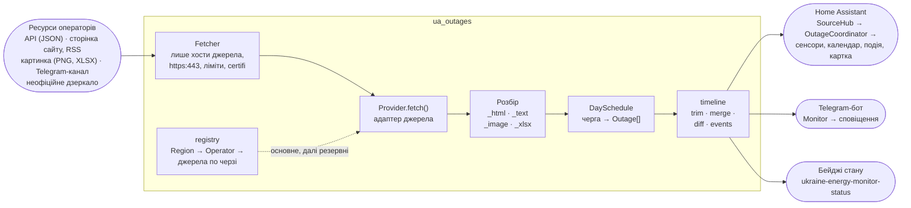
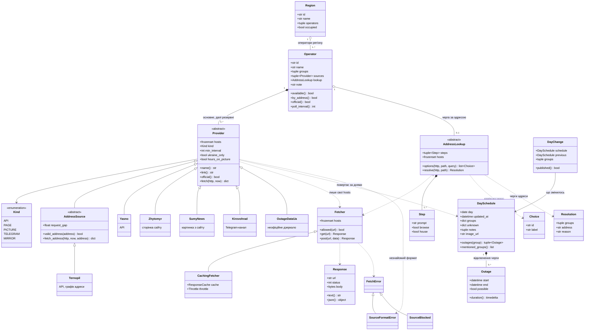

# Архітектура `ua_outages`

Бібліотека перетворює те, що публікує кожен оператор (API, сторінку сайту, картинку, пост у
Telegram-каналі, відкрите дзеркало), на одну модель: `{день: DaySchedule}`, де для кожної черги —
інтервали відключень. Нею користуються інтеграція Home Assistant з цього репозиторію,
Telegram-бот [@grafik_ua_bot](https://t.me/grafik_ua_bot) і перевірка стану джерел (бейджі в README).
Як читається кожен оператор — [SOURCES.md](SOURCES.md).

## Як витягується графік

Від ресурсу оператора до спільної моделі. Кожен крок не довіряє попередньому: `Fetcher` пускає
лише на хости самого джерела, розбір обмежений за розміром і часом, а все, що не схоже на відомий
формат, стає `SourceFormatError`, а не «графіком». Довідники адрес (`AddressLookup`, «адреса →
черга») ходять через той самий `Fetcher`; `status` проганяє кожне джерело й дає бейджі.

## Модель і джерела

Головні класи. Кожен оператор має впорядкований список джерел: перше — основне, решта — резерв,
до якого доходить черга, коли попереднє не відповідає. Конкретних адаптерів понад двадцять; на
діаграмі — по одному кожного виду (`Kind`), решта — у [SOURCES.md](SOURCES.md).

## Модулі

| Модуль | Що в ньому |
|---|---|
| `models.py` | `Outage`, `Slot`, `DaySchedule`: спільна модель, час Києва |
| `http.py` | `Fetcher` (дозволені хости, https:443, ліміти, TLS із `certifi`), `CachingFetcher`, `ResponseCache`, `Throttle`, `redact` |
| `providers/base.py` | `Provider`, `AddressSource`, `AddressLookup` і їхні типи, `Kind`, помилки |
| `providers/*.py` | адаптер кожного джерела й довідника адрес |
| `providers/_html.py`, `_text.py`, `_image.py`, `_xlsx.py` | безпечний розбір HTML, тексту, PNG і XLSX з лімітами |
| `registry.py` | `Region`, `Operator`, усі області й оператори, порядок джерел |
| `timeline.py` | `trim_schedules`, `merge_schedules`, `diff_schedules` → `DayChange`, `group_events`, `current_outage`, `next_outage` |
| `status.py` | перевірка кожного джерела, бейджі, таблиця README |
| `custom_components/ukraine_outages/` | інтеграція Home Assistant: `SourceHub` (одне звернення на оператора для всіх записів) → `OutageCoordinator` → сенсори, бінарні сенсори, календар, подія «Графік» (з `diff_schedules`), Repairs; картка (`card.py` віддає їй дані через websocket, `frontend/` — сама картка); власна копія `ua_outages` |
